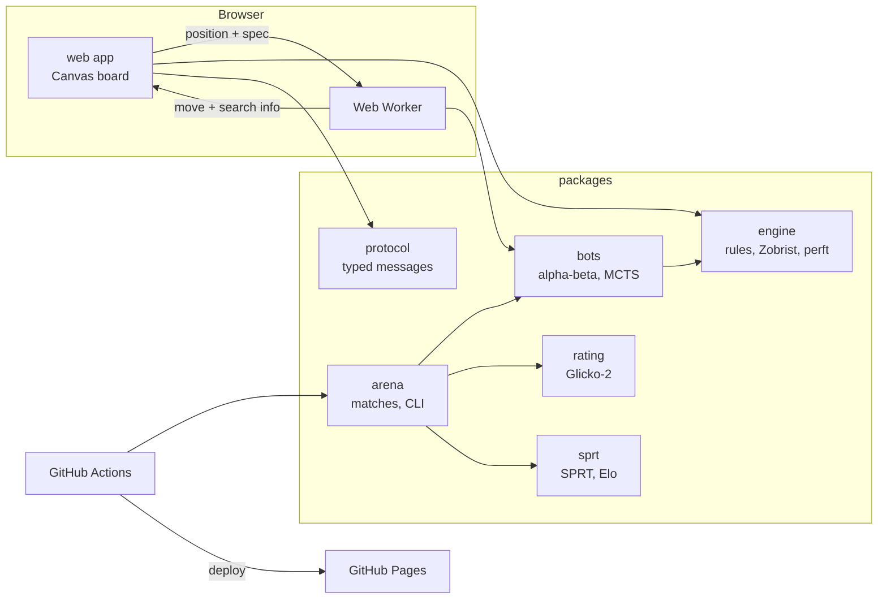

# Hasik

**Play Sungka, the Filipino mancala, against AI that searches like a chess engine.**

[Play now](https://robertgeraldsenasin.github.io/hasik/) · [How it was built](docs/guide/02-how-it-was-built.md) · [Design decisions](docs/decisions/) · [Spec](docs/spec/)

[](https://github.com/robertgeraldsenasin/hasik/actions/workflows/ci.yml)
[](https://github.com/robertgeraldsenasin/hasik/actions/workflows/deploy.yml)
[](docs/decisions/ADR-0005-sprt-strength-gate.md)
[](LICENSE)

*Hasik* is Tagalog for "to sow", the one move in Sungka.

## What's inside

- **Engine:** configurable Sungka rules (every regional difference is a flag), perft-verified move generation, incremental Zobrist hashing, zero dependencies, no I/O. It runs the same in the browser, in Node and in CI.
- **AI:** negamax alpha-beta with iterative deepening, a two-tier transposition table, move ordering (TT move, extra turns, captures, killers, history) and an extra-turn extension; plus Monte Carlo Tree Search (UCT) as a second, independent AI.
- **Ratings:** Glicko-2 leaderboard from round-robin tournaments over a committed opening book.
- **CI strength gate:** every change to the engine plays the base branch in an SPRT match (Sequential Probability Ratio Test) and cannot merge unless it is proven not to be weaker. Stockfish's testing framework decides what ships the same way.
- **Web app:** Canvas board with drop-by-drop sowing animation, bots in a Web Worker (the page never freezes), five difficulty levels plus MCTS, an engine-insight panel showing depth, nodes/s, evaluation and the expected line. About 16 KB gzipped.
- **Helpers for players:** a move preview that marks where the last shell lands, a hint mode that searches every legal move and puts its score on the board, undo, a game that survives a reload, a win record per opponent, sound effects, and a how-to-play guide. Every view passes an axe accessibility scan in light and dark mode.

## Results

All numbers below are generated from committed files in [`results/`](results/) by `pnpm readme:tables`, and CI fails if they are edited by hand. Bots use fixed node or playout budgets, so every table reproduces exactly on any machine.

<!-- results:roundrobin:start -->
Round robin: 40 game pairs per pairing (80 games), 200 balanced openings, colours swapped within each pair. Hardware: Intel(R) Xeon(R) Processor @ 2.10GHz, 2 cores, 8 GB RAM, linux 6.18.44-fc-v185, Node v22.23.4.

| Bot | Glicko-2 (± 2 RD) | Score vs field | Score vs Greedy | Elo vs Greedy (95% CI) |
| --- | --- | --- | --- | --- |
| Minimax (50k nodes) | 1887 ± 52 | 87.5% | 100.0% | +∞ (won every game) |
| Minimax (5k nodes) | 1807 ± 52 | 79.8% | 98.1% | +688 (+529 to +∞) |
| MCTS (5k playouts) | 1588 ± 52 | 58.5% | 90.0% | +382 (+286 to +561) |
| MCTS (1k playouts) | 1488 ± 52 | 48.9% | 91.9% | +421 (+320 to +633) |
| Greedy | 1177 ± 52 | 18.8% | — | — |
| Random | 1052 ± 52 | 6.6% | 26.3% | −179 (−266 to −110) |
<!-- results:roundrobin:end -->

### Search

<!-- results:search:start -->
Nodes needed to finish a depth-6 search, summed over 10 opening positions:

| Search | Nodes | vs plain minimax |
| --- | --- | --- |
| Plain minimax | 463,805 | — |
| + alpha-beta pruning | 43,036 | 10.8× fewer |
| + move ordering | 9,839 | 47.1× fewer |
| + transposition table | 9,816 | 47.2× fewer |

What each technique is worth in play: the full search vs the same search with one technique off, both at 10,000 nodes per move, 40 game pairs each:

| Technique switched off | Full search W/D/L | Elo gained by the technique (95% CI) |
| --- | --- | --- |
| Transposition table | +39 =6 −35 | +17 (−22 to +57) |
| Move ordering | +40 =6 −34 | +26 (−17 to +70) |
| Extra-turn extension | +37 =6 −37 | 0 (−34 to +34) |
| Alpha-beta pruning | +54 =6 −20 | +158 (+101 to +223) |

Engine speed: perft 1,548,418 leaves/s (depth 6, 48,263 leaves); search 783,514 nodes/s, average depth 7.6 at 200 ms and 9.2 at 1 s. Hardware: Intel(R) Xeon(R) Processor @ 2.10GHz, 2 cores, 8 GB RAM, linux 6.18.44-fc-v185, Node v22.23.4.
<!-- results:search:end -->

## Run it

Requirements: Node 22+ and pnpm (`corepack enable` installs the version pinned in `package.json`).

```bash
git clone https://github.com/robertgeraldsenasin/hasik.git
cd hasik
pnpm install
pnpm dev                     # play locally at http://localhost:5173
pnpm verify                  # everything CI checks: lint, format, types, boundaries, tests
```

Opening the folder in VS Code offers the recommended extensions, and the Run Task and Run and Debug menus have ready-made entries (see [docs/guide/01-local-setup-vscode.md](docs/guide/01-local-setup-vscode.md)). A dev container is included for Codespaces.

| Command | What it does |
| --- | --- |
| `pnpm perft 6` | Move-generation leaf counts and speed from the start position |
| `pnpm arena --a minimax:nodes=20000 --b greedy --pairs 100` | A match between any two bots, colours swapped per opening |
| `pnpm roundrobin --pairs 40` | Full tournament → `results/roundrobin.json` and the web leaderboard |
| `pnpm sprt --base base.mjs --head head.mjs` | The strength-gate test between two engine bundles |
| `pnpm bench` / `pnpm ablation` | Speed, depth and what each search technique is worth |
| `pnpm readme:tables` | Regenerate the tables above from `results/` |

Bot specs are short strings: `random`, `greedy`, `minimax:depth=3`, `minimax:ms=200`, `minimax:nodes=20000,tt=0`, `mcts:playouts=2000,policy=random`.

## Architecture



`engine` imports nothing; `bots` imports only `engine`. CI enforces these boundaries ([scripts/check-boundaries.mjs](scripts/check-boundaries.mjs)). A tour of the code with the lines worth explaining is in [docs/guide/03-architecture-tour.md](docs/guide/03-architecture-tour.md).

## How it works

- **Rules and indexing.** 16 slots: A's houses 0-6, A's store 7, B's houses 8-14, B's store 15. Opposite house = 14 − i. A precomputed next-slot table per player skips the opponent's store. [ADR-0001](docs/decisions/ADR-0001-rule-variant.md)
- **Extra turns break naive negamax.** After a move that ends in your own store you move again, so the search negates the child score only when the side to move actually changes. A test compares alpha-beta with a classic max/min minimax that never negates, so this bug cannot hide.
- **Zobrist + transposition table.** 64-bit keys stored as two 32-bit halves (BigInt is too slow), updated incrementally; two-tier buckets; logically cleared per move so the same position always gets the same answer. [ADR-0002](docs/decisions/ADR-0002-hashing-and-transposition-table.md)
- **MCTS.** UCT with ε-greedy playouts. Each node remembers who moved into it, so backpropagation stays correct with extra turns.
- **Glicko-2.** Implements Glickman's paper step by step and reproduces its worked example in a test.
- **SPRT gate.** Paired games (same opening, colours swapped), pentanomial model, fixed node budget, non-regression bounds [−10, 0] Elo or gainer bounds [0, 5]. [ADR-0005](docs/decisions/ADR-0005-sprt-strength-gate.md)

## Testing

| Level | What it proves |
| --- | --- |
| Unit | Every item in the rules checklist, including a move traced by hand from the start position |
| Differential | Thousands of random games under random rule variants agree move-for-move with an independent reference implementation |
| Property (fast-check) | Shells conserved, input never mutated, incremental hash = full recompute, legal moves exact, games terminate |
| Golden | Perft counts at depths 0-6 lock the move generator |
| Search | Alpha-beta = classic minimax; pruning, ordering and the TT never change the root value |
| Statistics | Glickman's Glicko-2 example; hand-computed SPRT values |
| Web | The move preview agrees with the engine on every legal move of many positions; a saved game is restored only if every move replays legally; hint mode scores a game-ending move exactly |
| End-to-end | Playwright, on the production build: three moves against level 3; preview, hint, undo and resume after a reload; shortcuts ignore modifier keys |
| Strength | The SPRT gate on every engine pull request |

## Decisions

[docs/decisions/](docs/decisions/): rule variant, hashing and TT design, name, retiring the hand-written-core constraint, the SPRT gate, hosting, monorepo tooling, the opening book.

## What I'd improve

- Reuse the transposition table between moves, and measure whether it gains Elo at fixed time.
- A retrograde endgame tablebase (milestone 2) for perfect play with few shells left.
- Online play with an authoritative server, replays and a live leaderboard (milestone 2).
- A faster engine core (fewer allocations per move, or Rust/WebAssembly) and SPSA tuning of the evaluation weights.

## Credits and AI use

Built by Zea and Soul (fill in who built what). The code in this repository, including the engine, search, MCTS, Glicko-2 and SPRT, was written with AI assistance and is verified by the test suite described above ([ADR-0004](docs/decisions/ADR-0004-retire-hand-written-core.md)).

Rules follow the variant in [ADR-0001](docs/decisions/ADR-0001-rule-variant.md) and `docs/spec/02_GAME_RULES.md`; regional variants differ. Original name and art; not affiliated with any existing Sungka app.

Licensed under the [MIT License](LICENSE).
