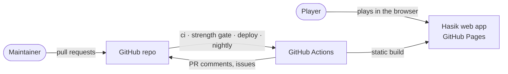
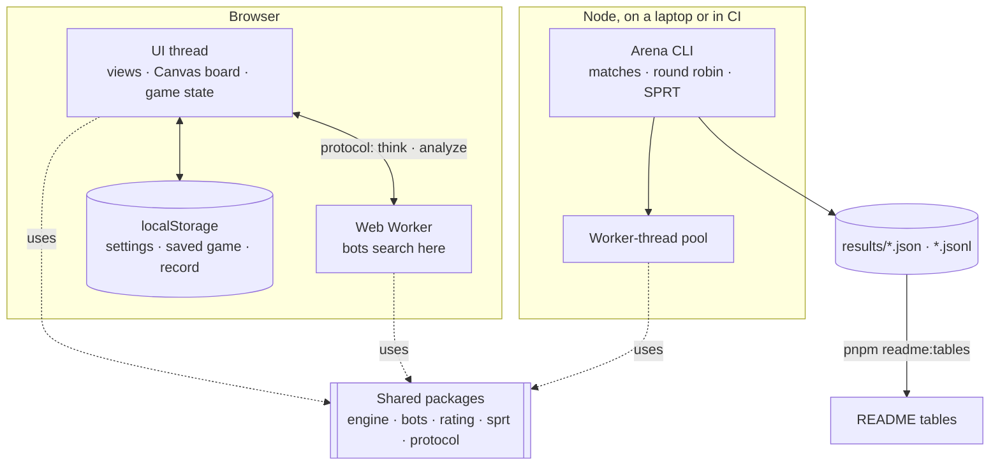
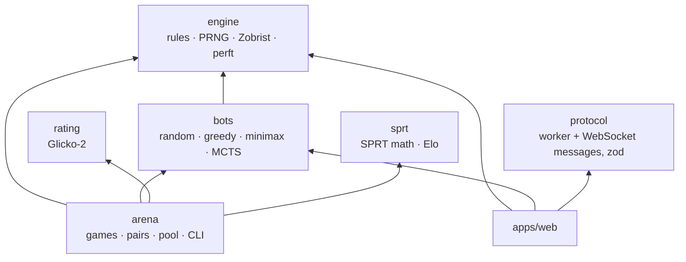
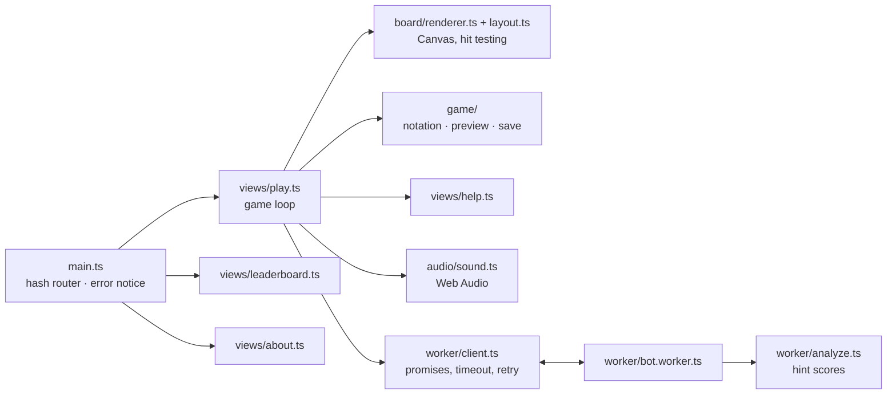
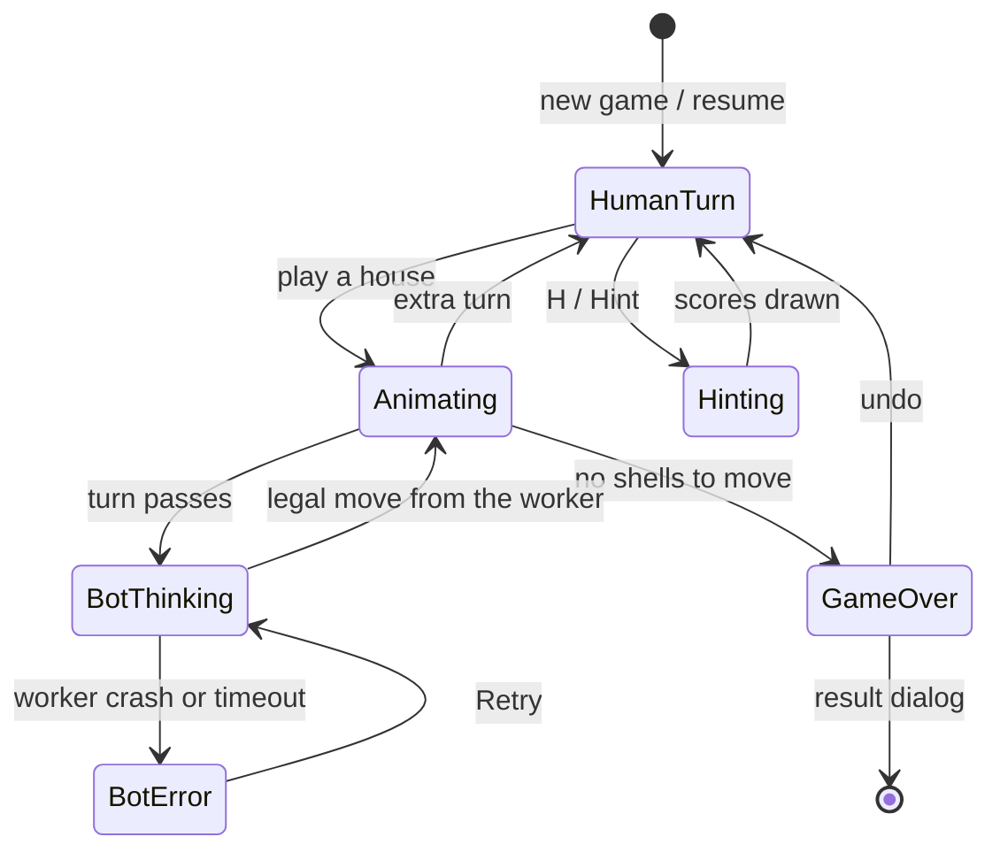
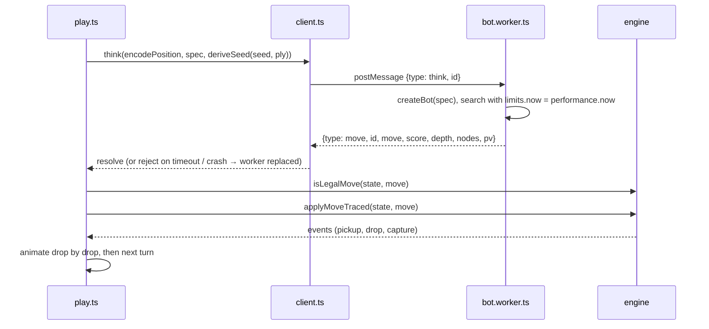
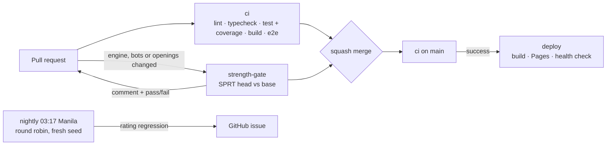
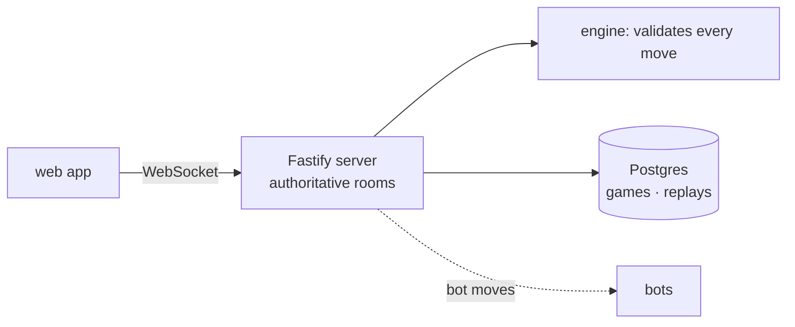

# Architecture

How Hasik is built today (November 2026, after milestone 1 and the play-experience update). The
original planning document is [`spec/03_ARCHITECTURE.md`](spec/03_ARCHITECTURE.md); where they differ,
this file describes the code as it is. Decisions behind each choice are in [`decisions/`](decisions/README.md).

Diagrams follow the C4 model (context → containers → components) and render on GitHub.

## 1. Context

Milestone 1 has no server: everything a player touches runs in the browser. The server, database and
replays are milestone 2 ([roadmap](guide/08-roadmap.md)).

## 2. Containers

The same engine and bots run unchanged in the browser worker, in Node worker threads and in tests,
because they are pure, dependency-free and deterministic (ADR-0004, ADR-0007).

## 3. Packages and boundaries

Arrows point from importer to imported. `scripts/check-boundaries.mjs` enforces this in CI by reading
both `package.json` dependencies and the actual import statements; `engine`, `rating` and `sprt` have no
runtime dependencies at all.

| Package    | Responsibility                                                                                                                                       | Key entry points                                                                               |
| ---------- | ---------------------------------------------------------------------------------------------------------------------------------------------------- | ---------------------------------------------------------------------------------------------- |
| `engine`   | Rules (every regional variant is a flag), move generation with traced sowing events, incremental Zobrist hashing, seeded PRNG, perft                 | `applyMove`, `applyMoveTraced`, `legalMoves`, `finalScore`, `createRng`, `deriveSeed`, `perft` |
| `bots`     | Bot registry and specs (`minimax:nodes=50000`), negamax alpha-beta with iterative deepening and a two-tier TT, move ordering, evaluation, MCTS (UCT) | `createBot`, `LEVELS`, `terminalScore`                                                         |
| `rating`   | Glicko-2                                                                                                                                             | `updateRating`                                                                                 |
| `sprt`     | SPRT (pentanomial), Elo estimates and intervals                                                                                                      | `sprtStatus`                                                                                   |
| `arena`    | Paired games over the opening book, worker-thread pool, CLI (`match`, `roundrobin`, `sprt`)                                                          | `playPair`, `pool.ts`, `cli.ts`                                                                |
| `protocol` | Shared message types: worker `think`/`analyze` requests and responses; WebSocket schemas for M2                                                      | `worker.ts`, `ws.ts`                                                                           |
| `apps/web` | Vite app: views, Canvas board, worker client, game helpers, audio                                                                                    | see section 4                                                                                  |
| `tools/`   | Opening book generator, benchmarks, ablation runs                                                                                                    | `openings/generate.ts`, `bench/*.ts`                                                           |

## 4. The web app

| Module              | Does                                                                                      | Tested by                                                          |
| ------------------- | ----------------------------------------------------------------------------------------- | ------------------------------------------------------------------ |
| `views/play.ts`     | Game loop, controls, dialogs, keyboard, persistence calls                                 | e2e (Playwright)                                                   |
| `game/preview.ts`   | What a house would do: landing slot, extra turn, relays, captures, store gain             | unit: agrees with the engine on every legal move of many positions |
| `game/save.ts`      | Validated localStorage (settings, saved game, record); replay of saved moves; undo target | unit: malformed input, illegal replays, streaks                    |
| `game/notation.ts`  | Move text, score formatting, per-player stats, share text                                 | unit                                                               |
| `worker/analyze.ts` | Scores every legal move for hint mode                                                     | unit: exact score for a game-ending move                           |
| `worker/client.ts`  | Request/response over `postMessage`; timeout; worker replacement; `CancelledError`        | e2e                                                                |
| `board/*`           | Layout, hit testing, drawing (preview ring, hint chips)                                   | unit (layout), e2e                                                 |

### The game loop

**Cancellation.** Every asynchronous step (an animation, a bot search, a hint) records the game
`token` when it starts and stops if the token has changed when it resumes. New game, undo and leaving
the page all bump the token and cancel the worker, so stale work can never apply a move to the wrong
game. `play()` returns whether it completed, and callers only continue when it did. This closed the
race recorded in the [debug log](debug-log.md) (2026-11-16).

**Hint mode.** The UI sends `analyze` with the position and a fixed node budget
(`minimax:nodes=30000`). The worker applies each legal move and searches the child. If the mover keeps
the turn (an extra turn), the child's score is already from the mover's view; otherwise it is negated:
the same sign rule as the search itself. Game-ending children use `terminalScore` directly.

**Persistence.** Settings, the game in progress (seed, opponent, side, move list) and the record live in
`localStorage`. Everything read back is validated, and a saved game is restored only if every move
replays legally through the engine. Games that used hints or undo are not counted in the record
(ADR-0009).

### A bot move, end to end

## 5. CI/CD

| Workflow            | Trigger                                                           | Gate                                                                                                                                                |
| ------------------- | ----------------------------------------------------------------- | --------------------------------------------------------------------------------------------------------------------------------------------------- |
| `ci.yml`            | every push to main, every PR                                      | ESLint (incl. the clock/random ban), Prettier, dependency boundaries, README tables, typecheck, Vitest with coverage gates, build, Playwright smoke |
| `strength-gate.yml` | PRs touching `packages/engine`, `packages/bots`, `tools/openings` | SPRT must not reject the head as weaker (ADR-0005); labels choose the mode                                                                          |
| `deploy.yml`        | `ci` succeeded on main                                            | builds for the `/hasik/` sub-path, deploys to Pages, then fetches the live site as a health check                                                   |
| `nightly.yml`       | daily 19:17 UTC                                                   | fresh-seed round robin; opens an issue on a rating regression                                                                                       |

`main` is protected; merges are squash-only and merged branches are deleted automatically.

## 6. Determinism and reproducibility

- No `Math.random`, `Date.now` or `performance.now` in engine, bots, rating, sprt (ESLint rule). Clocks
  are injected through `limits.now`; the web worker is the only place that passes a real clock.
- All randomness comes from `createRng(seed)`; per-move seeds from `deriveSeed(gameSeed, ply)`.
- The TT is logically cleared each move, so a position and limits always give the same move.
- Matches use node or playout budgets, not time, so every number in `results/` can be regenerated
  exactly, and the README tables are generated from those files (CI fails on hand edits).

## 7. Testing at a glance

| Layer        | Examples                                                                                                                                                                                                      |
| ------------ | ------------------------------------------------------------------------------------------------------------------------------------------------------------------------------------------------------------- |
| Engine       | Perft golden values; property test: 98 shells conserved, input never mutated, incremental hash exact; every rule flag                                                                                         |
| Bots         | Alpha-beta matches classic max/min minimax at depths 1–4; pruning, ordering and the TT don't change the root value; extra turns chained before captures; determinism; minimax beats greedy, MCTS beats random |
| Rating, SPRT | Glickman (2013) worked example; SPRT against a hand computation; no decision before the minimum sample; unbounded Elo intervals reported as infinite                                                          |
| Arena        | In-thread and worker-thread runs give identical, ordered results                                                                                                                                              |
| Web          | Preview vs engine on many positions; storage parsing; replay; hint scores; Playwright smoke (help, preview, hint, undo, resume, modifier keys, leaderboard)                                                   |

Details: [guide/06-testing-and-ci.md](guide/06-testing-and-ci.md).

## 8. Planned for milestone 2 (not built yet)

Plus an endgame tablebase, TT reuse between moves, Docker and a hosting ADR. The WebSocket message
schemas already exist in `packages/protocol/src/ws.ts`.
